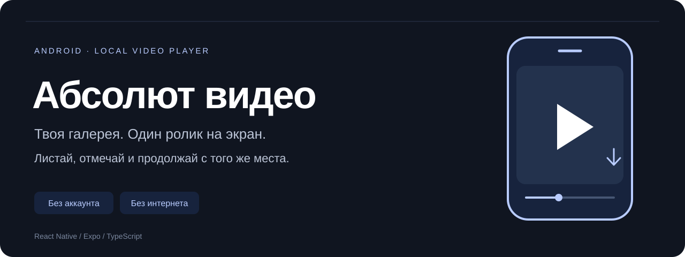

<p align="center">
  
</p>

<p align="center">
  <a href="https://github.com/xChessman-dev/absolut-video/actions/workflows/checks.yml"></a>
  
  
  
  <a href="LICENSE"></a>
</p>

# Абсолют видео

Видео из галереи телефона в вертикальной ленте. Один ролик на экран, свайп для перехода, минимум элементов поверх изображения. Просмотр работает без регистрации, сервера и подключения к интернету.

## Возможности

| Просмотр | Управление коллекцией |
| --- | --- |
| Автозапуск, пауза касанием и перемотка | Все доступные видео из медиатеки Android |
| Горизонтальное видео целиком, без обрезки | Избранное с отдельным фильтром |
| Повтор или переход к следующему после окончания | Новые сначала или перемешивание без дубликатов |
| Звук включается и выключается одной кнопкой | Сохранение последнего ролика и настроек |
| Пауза при сворачивании и блокировке | Переход к видео по номеру |
| Отправка через системное меню Android | Порционное чтение каталога |

В ленте подготовлены только текущий ролик и его ближайшие соседи. Содержимое всей галереи не загружается в память. Фото и аудиофайлы не попадают в список.

## Установка

Приложение предназначено для **Android**. Для просмотра галереи нужен нативный APK; веб-версия показывает информационный экран.

1. Соберите APK по инструкции ниже или скачайте его из [релиза](https://github.com/xChessman-dev/absolut-video/releases), если он опубликован.
2. Установите приложение на телефон.
3. При первом запуске разрешите доступ ко всем видео или к выбранной подборке, если это поддерживает ваша версия Android.

Начиная с версии 1.2.0 приложение называется «Абсолют видео». Идентификатор пакета, формат настроек и локальный ключ подписи сохранены: сборка тем же ключом устанавливается поверх «Свои видео» и сохраняет подборки.

## Разработка

**Стек:** React Native 0.86, Expo SDK 57, React 19, TypeScript, Expo Router, expo-video, expo-media-library и AsyncStorage.

Нужны Node.js 24 и npm.

```sh
git clone https://github.com/xChessman-dev/absolut-video.git
cd absolut-video
npm ci
npm start
```

Для нативного запуска подготовьте Android SDK и JDK 17, затем выполните `npm run android`.

### Проверки

```sh
npm test
npm run typecheck
```

Тесты проверяют каталог из 1753 роликов, порядок и восстановление позиции, отметки, жесты перелистывания, перемотку и режимы окончания видео. Регрессионные проверки запускают реальные React-компоненты с заглушками Android: возврат из фона, поздний фокус окна, восстановление громкости, ручная пауза и сохранение режима без звука.

Нативный декодер, фактическое звучание и поведение конкретной прошивки нужно дополнительно проверять на телефоне.

### Release APK на Windows

Понадобятся JDK 17, Android SDK с Platform / Build Tools 36 и соответствующий NDK. Лицензии SDK должны быть приняты владельцем окружения.

```powershell
npm run build:apk

# Если инструменты находятся в других каталогах:
pwsh -NoProfile -File scripts/build-apk.ps1 `
  -JavaHome 'C:/path/to/jdk17' `
  -AndroidSdk 'C:/path/to/Android/Sdk'
```

Результат: `artifacts/absolut-video-1.2.0.apk` и SHA-256 рядом с ним. Скрипт встраивает JavaScript в release-сборку и собирает `arm64-v8a`, `armeabi-v7a` и `x86_64`.

При первой сборке создаётся ключ в `.credentials/`. **Сохраните его резервную копию:** для обновлений нужен тот же ключ. Папка исключена из Git и не входит в публичный репозиторий. Собственная сборка с новым ключом не обновит установленную сборку другого автора.

## Структура

```text
src/
├── app/          # Экран галереи и маршрутизация
├── components/   # Лента, видеоплеер, шапка и управление
├── hooks/        # Доступ к медиатеке и сохранение настроек
└── lib/          # Каталог, порядок, пагинация и воспроизведение
tests/            # Логика и проверки компонентов
plugins/          # Подключение локальной подписи Android
scripts/          # Сборка APK и генерация иконки
assets/           # Иконки приложения
docs/             # Изображение для README
.github/workflows # Проверки при push и pull request
```

## Данные и разрешения

Приложение читает видео на телефоне и сохраняет настройки локально. Аккаунтов, аналитики и серверного хранилища в проекте нет. При обычном просмотре файлы не копируются.

Кнопка «Поделиться» создаёт временную копию одного ролика и открывает системное меню Android. Приложение и получателя выбирает пользователь. Копии старше суток очищаются при следующем запуске или отправке; для операции нужно свободное место размером с файл.

Облачные ролики без локальной копии и закрытые каталоги других приложений недоступны. Поддержка видеокодеков зависит от устройства.

## Лицензия

[MIT](LICENSE). Сохранено уведомление об авторских правах исходного шаблона Expo.
